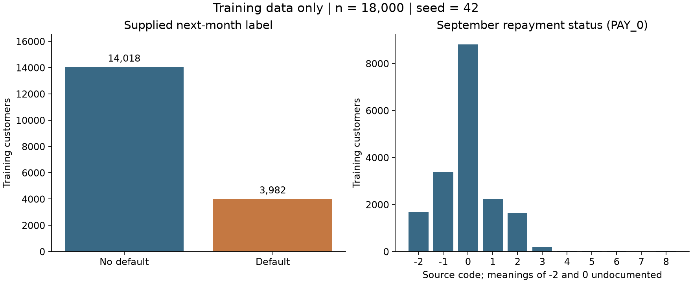

# Stage 1 data audit

Generated from the official workbook. No model has been trained.

## Structural checks

| Check | Observed value |
|---|---:|
| rows | 30000 |
| source_predictors | 23 |
| model_predictors | 21 |
| missing_cells | 0 |
| duplicate_ids | 0 |
| duplicate_rows_beyond_first_excluding_id | 35 |
| duplicate_source_profiles_beyond_first | 56 |
| model_profiles_shared_across_partitions | 59 |

## Split assignment

| Partition | Rows |
|---|---:|
| test | 6000 |
| train | 18000 |
| validation | 6000 |

Seed: 42. IDs sorted before stratification. No chronological meaning is assigned to ID.

## Training subset only

- Default: 3,982
- No default: 14,018
- Observed default rate: 22.12%

## Limitations

- Historical Taiwan snapshot; no temporal or US-population validation.
- Distinct IDs with shared profiles retained; hidden entity duplication cannot be excluded.
- SEX and MARRIAGE audit-only; removing them does not establish fairness.
- Undocumented category semantics are not inferred.
- Model metrics and business impact: [需要真实信息].

Code counts and training numeric summaries are in `data_audit.json`.
Shared-profile counts describe groups of identical allowed predictor values, not proven duplicate people.
