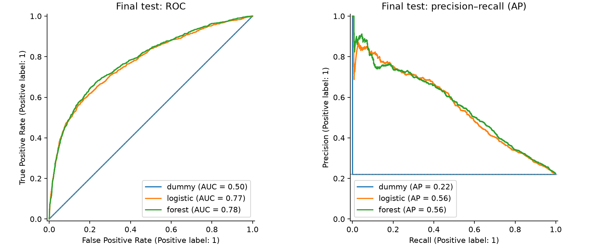
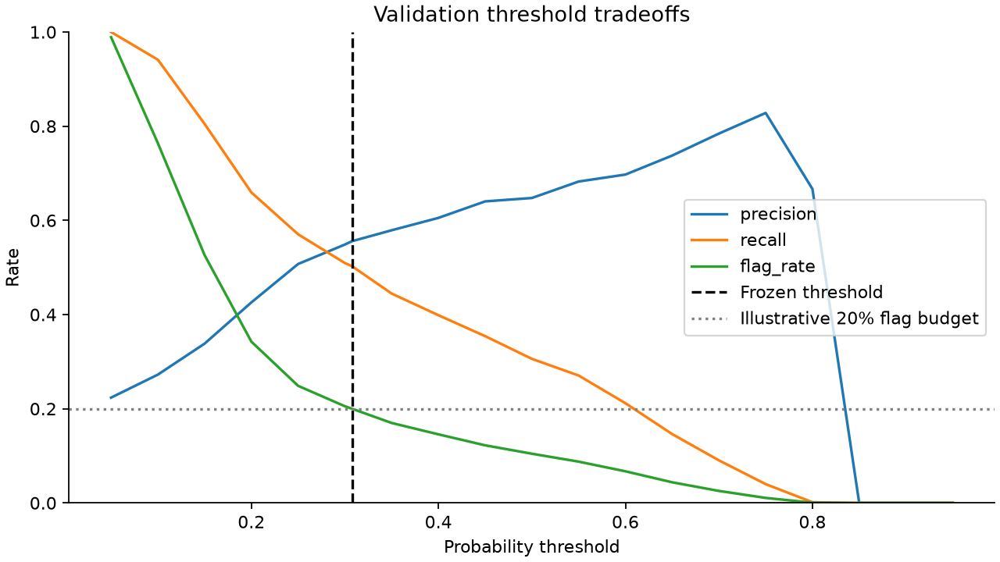
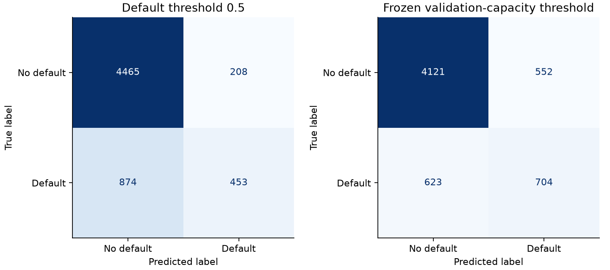
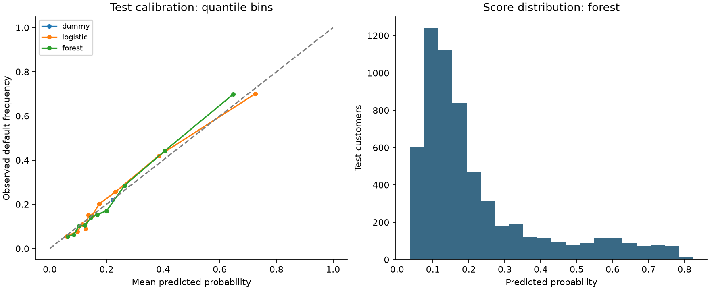
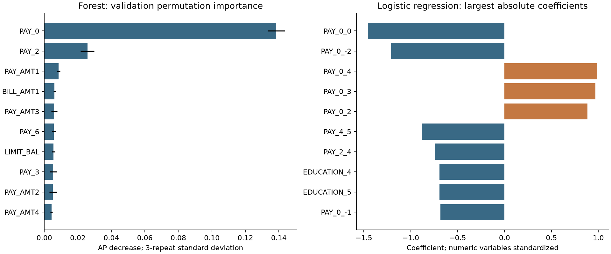

# Credit Card Default Risk — results and interpretation

All numbers below come from `artifacts/baseline/`; no model was chosen using these test results.
The fixed split contains 18,000 training, 6,000 validation and 6,000 test customers.
Positive label 1 means the supplied next-month default outcome.

## Selection before the final test

Training-only stratified three-fold cross-validation compared four configurations.
Logistic regression uses C=1 with either no weighting or balanced class weights.
The random forests use 150 trees, minimum leaf size 20, and maximum depth 6 or 12.
Preprocessing is part of every fitted pipeline. All other choices were fixed.

| family | configuration | mean_ap | std_ap | mean_roc_auc |
| --- | --- | --- | --- | --- |
| logistic | unweighted | 0.5455 | 0.0095 | 0.7667 |
| logistic | balanced | 0.5435 | 0.0101 | 0.7671 |
| forest | depth6 | 0.5461 | 0.0084 | 0.7759 |
| forest | depth12 | 0.5529 | 0.0054 | 0.7835 |

Configuration and family were selected by mean training-CV AP. The selected family
was **forest**. Fold standard deviations describe three folds;
they are not confidence intervals or evidence of statistical superiority.

Train-only cross-validation fitted sigmoid calibrators using out-of-fold scores.
The final base estimators were fit on training data only. Validation Brier score
selected raw versus sigmoid for the chosen family, with raw winning ties.

| model | roc_auc | average_precision | brier | log_loss |
| --- | --- | --- | --- | --- |
| dummy | 0.5000 | 0.2212 | 0.1723 | 0.5284 |
| logistic | 0.7532 | 0.5138 | 0.1411 | 0.4478 |
| logistic_sigmoid | 0.7532 | 0.5138 | 0.1410 | 0.4474 |
| forest | 0.7740 | 0.5337 | 0.1380 | 0.4368 |
| forest_sigmoid | 0.7740 | 0.5337 | 0.1392 | 0.4409 |

The selected final model is **forest**. Sigmoid calibration
did not improve the forest's validation Brier score, so it was not selected.
Brier score reflects discrimination and uncertainty as well as calibration;
the reliability diagram is also needed. Logistic regression's sigmoid variant
slightly improves validation Brier here, but does not change the family decision.
`ensemble=False` makes these sigmoid transformations monotonic, so ranking metrics
remain identical to each corresponding raw model. Calibration need not improve AP.

## Frozen test results

AP is `average_precision_score`, the reported PR-AUC convention; it is not the
trapezoidal area under a linearly interpolated precision–recall curve.
The constant-probability dummy has test AP equal to test prevalence (0.2212).

| model | policy | roc_auc | average_precision | brier | precision | recall | f1 | flag_rate |
| --- | --- | --- | --- | --- | --- | --- | --- | --- |
| dummy | 0.5 | 0.5000 | 0.2212 | 0.1723 | 0.0000 | 0.0000 | 0.0000 | 0.0000 |
| logistic | 0.5 | 0.7745 | 0.5565 | 0.1349 | 0.6870 | 0.3557 | 0.4687 | 0.1145 |
| logistic_sigmoid | 0.5 | 0.7745 | 0.5565 | 0.1349 | 0.6908 | 0.3519 | 0.4663 | 0.1127 |
| forest | 0.5 | 0.7829 | 0.5630 | 0.1340 | 0.6853 | 0.3414 | 0.4557 | 0.1102 |
| forest_sigmoid | 0.5 | 0.7829 | 0.5630 | 0.1342 | 0.6718 | 0.3640 | 0.4721 | 0.1198 |
| forest | validation_capacity | 0.7829 | 0.5630 | 0.1340 | 0.5605 | 0.5305 | 0.5451 | 0.2093 |

The forest improves test AP over raw logistic regression by about 0.0065 in this
split. That is a modest observed difference, not proof that forests always win.
The logistic baseline remains useful because its assumptions and coefficients
are easier to discuss.

For the frozen selected model, 200 fixed-seed bootstrap resamples give percentile
95% intervals: ROC-AUC [0.769, 0.797],
AP [0.536, 0.589].
These exclude model-selection and population-shift uncertainty and assume sampled
records are sufficiently independent; hidden entity duplication weakens that assumption.

## Decision threshold: a review illustration

The hypothetical review budget is at most 20% of the validation sample. This is a
scenario assumption, not a bank's real process. Tied score groups are either fully
flagged or excluded; the algorithm never breaks ties by customer ID or outcome.
The threshold is **0.307695**, fixed before test scoring.

At 0.5, the selected model has test precision 68.5%, recall
34.1%, and flags 11.0% of customers. At the frozen working
threshold, precision is **56.1%**, recall **53.1%**,
and the flag rate is **20.93%**.

The working point flags 1,256 customers, including
704 supplied defaults and 552 non-defaults. It misses
623 defaults; 4,121 non-defaults are not flagged.
Rows in the confusion matrix are actual labels; columns are predicted labels.

The test flag rate exceeds 20% because a fixed probability threshold does not
enforce a hard future quota. A top-k operational policy would be a different policy,
not retroactively substituted into this test evaluation. Neither flagging nor recall
proves that review prevents a default. Real intervention costs, loss severity and
financial benefits are **[需要真实信息]**.

For rows with no flagged cases, precision and F1 are displayed as zero using the
explicit `zero_division=0` convention. Precision is mathematically undefined there;
the far-right drop in the threshold plot reflects that convention. Subgroup
precision/recall/FPR instead use suppression when their denominator is below 20.

## Probability calibration

The reliability plot uses ten quantile bins; tied probabilities can reduce the
number of distinct bins. Bins have sampling noise and are not formal calibration
tests. The score histogram shows where the selected model makes predictions.
Both raw and calibrated numerical results are retained even though raw was selected.

## Feature interpretation

Validation permutation importance for the raw forest places September repayment
status (`PAY_0`) first. Its average AP decrease is about 0.1385 over three repeats.
Correlated monthly histories can share importance, so values do not establish
causal importance or identify an actionable intervention.

The logistic coefficient table describes the raw logistic model. Numeric features
are standardized; a numeric coefficient corresponds to a one-training-standard-
deviation change, holding other encoded features fixed. All nominal levels are
one-hot encoded with L2 regularization, so no single category is dropped as a
reference. Compare coefficients between levels of the same variable rather than
interpreting one level as a baseline odds ratio. Rare codes and correlated histories
can produce unstable or counterintuitive coefficients. Codes -2 and 0 retain their
source values without invented semantic labels.

## Modest subgroup diagnostic

Same selected model and same threshold for all groups. SEX and MARRIAGE are audit-only;
AGE is a predictor. Rates with denominators below 20 are suppressed; all counts
remain available in CSV/JSON. No group-specific thresholds were fitted.

| attribute | group | n | positives | negatives | flagged | recall | fpr | precision |
| --- | --- | --- | --- | --- | --- | --- | --- | --- |
| sex_source_code | female (source code 2) | 3628 | 755 | 2873 | 721 | 0.5351 | 0.1103 | 0.5603 |
| sex_source_code | male (source code 1) | 2372 | 572 | 1800 | 535 | 0.5245 | 0.1306 | 0.5607 |
| age_band | 30 to 49 | 3502 | 757 | 2745 | 672 | 0.5046 | 0.1056 | 0.5685 |
| age_band | 50 and older | 572 | 149 | 423 | 136 | 0.5168 | 0.1395 | 0.5662 |
| age_band | under 30 | 1926 | 421 | 1505 | 448 | 0.5819 | 0.1349 | 0.5469 |

Source-coded male and female groups have FPRs of roughly 13.1% and 11.0%, respectively.
Age-group recall ranges from about 50.5% to 58.2%. These are descriptive differences,
not causal effects, significance tests, fairness certification or US lending compliance.
Base rates differ, group definitions are incomplete, and proxy information can remain.
The oldest band has only 572 records, so apparent differences need cautious interpretation.

## Limits

- Historical Taiwan snapshot; no temporal, geographic or macroeconomic stress validation.
- Default operational definition and reporting lag are incompletely documented.
- The sample contains existing customers, not all applicants or rejected applications.
- Distinct IDs with identical predictor profiles are retained; 59 allowed-feature
  profile groups span partitions. Hidden entity duplication remains possible.
- No protected-attribute exclusion can prove absence of proxy discrimination.
- The 20% capacity is illustrative; no cost-optimal threshold or business value is established.
- Test results must not be used to tune this frozen run. A new experiment requires
  an explicitly labeled design and new evidence; repeated seed searches are not validation.
